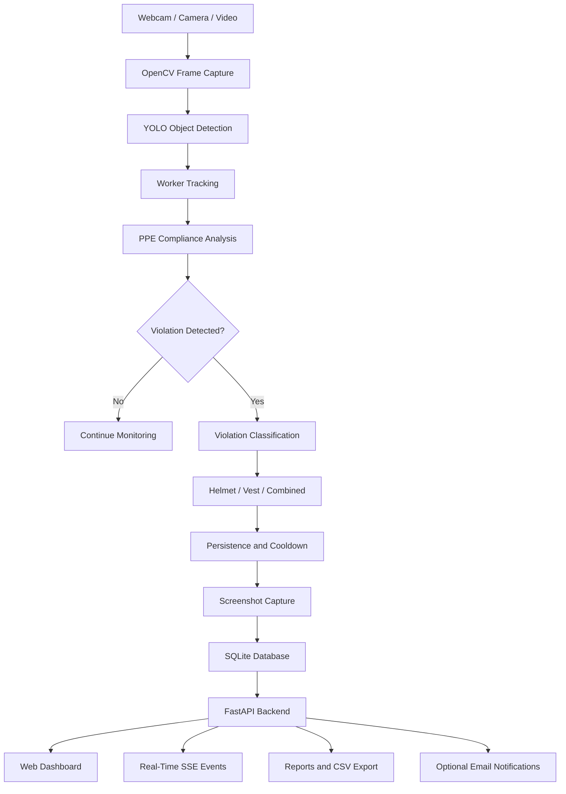

# Construction PPE Detection System
### AI-Based Construction Site Safety Monitoring Using YOLO and Computer Vision


## 1. Project Overview

Construction PPE Detection is an AI-powered construction site safety monitoring system developed to identify whether workers are wearing essential Personal Protective Equipment (PPE).

The system uses computer vision and a YOLO-based object detection model to monitor workers through a webcam or supported camera source.

It identifies potential PPE violations, records incidents, captures evidence screenshots, tracks workers within camera sessions and displays safety information through a web-based dashboard.

The application also provides daily and monthly reports, real-time dashboard notifications and optional email alerts.

### Problem Statement

Construction sites involve several safety risks. Workers who do not wear appropriate protective equipment may be exposed to serious injuries.

Traditional safety monitoring generally depends on manual inspection, which can be time-consuming and difficult to perform continuously.

This project proposes an AI-assisted monitoring solution that automatically analyzes camera frames and identifies potential PPE compliance violations.

### Proposed Solution

The system captures video frames from a connected camera and processes them using a trained YOLO object detection model.

The detected objects are analyzed to identify PPE compliance conditions. When a violation persists for the configured duration, the system records the incident, captures an annotated screenshot and updates the dashboard.

### Project Objectives

- Automate helmet and safety vest monitoring.
- Detect workers who are missing required PPE.
- Identify combined PPE violations.
- Track workers within camera sessions.
- Maintain violation history and screenshot evidence.
- Provide real-time dashboard notifications.
- Generate daily and monthly reports.
- Support optional email notifications.
- Provide a simple interface for operating the system.

---

## 2. Key Features

| Feature | Description |
|---|---|
| Helmet detection | Identifies missing helmet conditions |
| Safety vest detection | Identifies missing safety vest conditions |
| Combined violation | Records workers missing both helmet and vest |
| Worker tracking | Tracks workers using session-based IDs |
| Screenshot evidence | Saves annotated violation images |
| Live monitoring | Displays camera monitoring and detection information |
| Real-time alerts | Sends violation events to the dashboard |
| Worker history | Displays worker-wise violation records |
| Daily reports | Summarizes recorded violations by day |
| Monthly reports | Displays monthly violation statistics |
| CSV export | Exports report data |
| PDF output | Uses browser print and Save as PDF, where supported |
| Email notifications | Optional SMTP-based violation notifications |
| Camera management | Adds, edits and removes camera sources |
| Settings | Configures detection and notification settings |

### Violation Categories

The system supports three violation categories:

**1. NO-Hardhat**

A worker is detected without a helmet.

**2. NO-Safety Vest**

A worker is detected without a safety vest.

**3. COMBINED**

A worker is detected without both a helmet and a safety vest.

The system uses configurable persistence and cooldown settings to reduce duplicate incident records.

---

## 3. Technology Stack

| Technology | Purpose |
|---|---|
| Python | Main programming language |
| FastAPI | Backend API framework |
| Uvicorn | ASGI application server |
| YOLO / Ultralytics | Object detection |
| PyTorch | Deep learning framework |
| OpenCV | Camera access and image processing |
| NumPy | Numerical operations |
| SQLAlchemy | Database ORM |
| SQLite | Local database |
| aiosqlite | Asynchronous SQLite access |
| Alembic | Database migrations |
| Pydantic | Data validation |
| Pydantic Settings | Application configuration |
| HTML5 | Dashboard structure |
| CSS3 | Dashboard styling |
| JavaScript | Frontend functionality |
| Server-Sent Events (SSE) | Real-time dashboard events |
| SMTP | Optional email notifications |
| Pytest | Automated testing |

The dashboard uses plain HTML, CSS and JavaScript and does not require a separate Node.js frontend build process.

---

## 4. System Architecture



### How the System Works

1. A camera provides video frames.
2. OpenCV captures and processes the frames.
3. The YOLO model identifies objects.
4. Worker tracking assigns tracking IDs.
5. The PPE detection logic evaluates helmet and vest conditions.
6. The violation checker identifies potential violations.
7. Persistence settings determine whether the condition lasts long enough to record.
8. The screenshot module captures evidence.
9. The database stores the violation details.
10. FastAPI provides information to the dashboard.
11. The dashboard receives real-time events and displays alerts.
12. Reports summarize the recorded data.

---

## 5. Project Folder Structure

The following represents the main project components. Check the actual repository for the complete current directory structure.

```text
Construction-PPE-Detection/
│
├── app/
│   ├── main.py
│   │
│   ├── api/
│   │   └── routes/
│   │       ├── cameras.py
│   │       ├── stream.py
│   │       ├── violations.py
│   │       ├── workers.py
│   │       ├── reports.py
│   │       └── app_settings.py
│   │
│   ├── alerts/
│   │   ├── db_handler.py
│   │   └── email_handler.py
│   │
│   ├── camera/
│   │   └── manager.py
│   │
│   ├── core/
│   │   ├── config.py
│   │   ├── detector.py
│   │   ├── frame_annotator.py
│   │   ├── violation_checker.py
│   │   ├── events.py
│   │   ├── runtime_settings.py
│   │   ├── screenshots.py
│   │   └── violation_types.py
│   │
│   ├── db/
│   │   ├── models.py
│   │   └── session.py
│   │
│   ├── schemas/
│   │   ├── camera.py
│   │   └── violation.py
│   │
│   ├── services/
│   │
│   └── static/
│       ├── index.html
│       ├── style.css
│       └── app.js
│
├── Model/
│   └── ppe.pt
│
├── requirements/
│   ├── base.txt
│   ├── dev.txt
│   └── prod.txt
│
├── tests/
│   ├── unit/
│   └── integration/
│
├── Visuals/
│   └── ppe-detection-demo.mp4
│
├── violation_frames/
│
├── .env.example
├── .gitignore
├── Dockerfile
├── pyproject.toml
└── README.md
```

### Important Directories

- `app/api/routes/`: Backend API route handlers.
- `app/alerts/`: Violation and email notification handling.
- `app/camera/`: Camera management.
- `app/core/`: Detection, tracking, violation processing and screenshot functionality.
- `app/db/`: Database models and database session configuration.
- `app/schemas/`: Request and response validation schemas.
- `app/services/`: Application service logic.
- `app/static/`: Frontend dashboard.
- `Model/`: Main trained PPE model.
- `requirements/`: Dependency requirement files.
- `tests/`: Automated tests.
- `violation_frames/`: Saved violation evidence images.
- `Visuals/`: Available demonstration assets.

---

## 6. System Requirements

### Recommended Environment

| Requirement | Recommendation |
|---|---|
| Operating System | Windows 10 / Windows 11 |
| Python | Python 3.11 recommended |
| RAM | 8 GB minimum recommended; 16 GB preferable |
| Storage | Enough space for model weights, packages and screenshots |
| Processor | Modern Intel or AMD CPU |
| GPU | Optional |
| Camera | Laptop webcam or supported camera |
| Internet | Required for initial package/model downloads and email services |

The project can run on CPU, although detection speed depends on the processor, frame resolution and model workload.

Python 3.11 is recommended because the project's Docker configuration uses Python 3.11.

---

## 7. Installation and Setup – Windows

Follow these instructions to install and run the project on a new Windows machine.

### Step 1: Install Python

Install Python 3.11.

Verify the installation:

```powershell
py -3.11 --version
```

Expected:

```text
Python 3.11.x
```

If the Python launcher cannot find Python 3.11, install it and reopen PowerShell.

### Step 2: Clone the repository

```powershell
git clone https://github.com/nnaidev02Amer/Construction-PPE-Detection.git
```

Navigate into the project:

```powershell
cd Construction-PPE-Detection
```

### Step 3: Create a virtual environment

```powershell
py -3.11 -m venv venv
```

A virtual environment keeps project dependencies separate from globally installed Python packages.

### Step 4: Activate the virtual environment

```powershell
.\venv\Scripts\Activate.ps1
```

Your PowerShell prompt should display:

```text
(venv) PS C:\...\Construction-PPE-Detection>
```

If PowerShell blocks activation, use:

```powershell
Set-ExecutionPolicy -Scope Process -ExecutionPolicy Bypass
.\venv\Scripts\Activate.ps1
```

### Step 5: Upgrade pip

```powershell
python -m pip install --upgrade pip
```

### Step 6: Install project dependencies

For normal development and testing, install:

```powershell
python -m pip install -r requirements/dev.txt
```

The development requirements file includes the base runtime requirements and development/testing packages.

If you only need to run the application without development tools, use:

```powershell
python -m pip install -r requirements/base.txt
```

Do not install multiple requirement files unnecessarily.

### Step 7: Verify package installation

```powershell
python --version
python -m pip check
```

Verify the core imports:

```powershell
python -c "import fastapi, uvicorn, pydantic, pydantic_settings, sqlalchemy, aiosqlite, alembic, ultralytics, cv2, torch, torchvision, numpy, aiosmtplib, httpx; print('All core packages imported successfully')"
```

If the command succeeds, the main backend packages are available in the active environment.

---

## 8. Required Python Packages

The authoritative package list is maintained in `requirements/base.txt`, `requirements/dev.txt` and `requirements/prod.txt`.

### Core Dependencies

| Package | Purpose |
|---|---|
| fastapi | Backend REST API |
| uvicorn | Runs the FastAPI application |
| pydantic | Validates application data |
| pydantic-settings | Loads environment configuration |
| sqlalchemy | Database ORM |
| aiosqlite | Asynchronous SQLite database operations |
| alembic | Database schema migrations |
| ultralytics | YOLO model loading and inference |
| opencv-python | Camera and image processing |
| torch | Deep learning operations |
| torchvision | Computer vision utilities |
| numpy | Array and numerical processing |
| aiosmtplib | Asynchronous SMTP email |
| httpx | HTTP client |
| python-dotenv | Environment variable support |
| python-multipart | Multipart form-data support |

### Development Dependencies

The development requirements also include:

| Package | Purpose |
|---|---|
| pytest | Automated testing |
| pytest-asyncio | Testing asynchronous functionality |
| pytest-cov | Test coverage |
| anyio | Asynchronous compatibility |
| ruff | Python linting |

### Requirements Files

- `requirements/base.txt`: Application runtime dependencies.
- `requirements/dev.txt`: Base dependencies plus testing and development tools.
- `requirements/prod.txt`: Base dependencies plus production server and PostgreSQL-related drivers.

Install the requirements file appropriate to your environment.

---

## 9. Environment Configuration

Create your local environment file:

```powershell
Copy-Item .env.example .env
```

The `.env.example` file contains the project's configuration template.

Open `.env` in your editor and review the available settings.

### Important Configuration

The project configuration includes settings for:

| Setting | Purpose |
|---|---|
| APP_ENV | Application environment |
| HOST | Server host |
| PORT | Server port |
| DATABASE_URL | Database connection |
| MODEL_PATH | Main PPE model location |
| DETECTION_CONFIDENCE | General detection threshold |
| PPE_ITEM_CONFIDENCE | PPE-specific detection threshold |
| VIOLATION_PERSIST_SECONDS | Time a violation must persist before recording |
| ENABLE_POSE | Enables or disables pose processing |
| Email settings | SMTP configuration and recipients |

Use the actual variable names and defaults in `.env.example` as the source of truth.

### Example Local Configuration

```env
APP_ENV=dev
HOST=127.0.0.1
PORT=8000

DATABASE_URL=sqlite+aiosqlite:///./ppe_detection.db

MODEL_PATH=Model/ppe.pt

DETECTION_CONFIDENCE=0.5
PPE_ITEM_CONFIDENCE=0.3

VIOLATION_PERSIST_SECONDS=3
ENABLE_POSE=false
```

These values are illustrative configuration examples. Preserve other settings already present in your `.env.example`.

**Security:** Never upload `.env` or real SMTP credentials to GitHub. Commit `.env.example` with placeholder values instead.

---

## 10. Model Configuration

The application uses a trained YOLO-based PPE detection model.

### Main Model

Expected model path:

```text
Model/ppe.pt
```

Verify the file exists:

```powershell
Test-Path .\Model\ppe.pt
```

If it returns `True`, the model file exists at the expected location.

If it returns `False`, check the repository's model installation instructions. Do not replace the model with unrelated pretrained weights.

### Model Responsibilities

The model is used for object detection and PPE-related analysis.

The detection pipeline processes camera frames, evaluates detections and passes relevant results to the violation-checking logic.

### Confidence Threshold

Detection confidence controls the minimum confidence required for accepting a detection.

A lower threshold may detect smaller or distant objects, but can also increase false detections.

A higher threshold may reduce false detections but can miss some PPE items.

The best value should be evaluated using real test images and video.

### Accuracy Limitations

- Detection quality depends on the model's training data.
- Small or distant workers can be difficult to classify.
- Poor lighting can reduce detection quality.
- Clothing that resembles safety vests can cause false detections.
- The system is an academic prototype and is not a certified industrial safety solution.

---

## 11. Running the Application

After completing installation and configuration, activate the virtual environment:

```powershell
.\venv\Scripts\Activate.ps1
```

Start the application:

```powershell
python -m uvicorn app.main:app --host 127.0.0.1 --port 8000
```

### Application URLs

| Service | URL |
|---|---|
| Main dashboard | http://127.0.0.1:8000 |
| API documentation | http://127.0.0.1:8000/docs |
| Alternative API documentation | http://127.0.0.1:8000/redoc |

Open the dashboard in your browser:

```text
http://localhost:8000
```

### Stop the application

In the PowerShell terminal running Uvicorn, press:

```text
CTRL + C
```

Restart the application after changing environment configuration.

---

## 12. Dashboard Operating Guide

The application contains six main dashboard sections.

### 1. Dashboard

The main dashboard provides an overview of the monitoring system.

It displays relevant information such as:

- Total workers detected.
- PPE compliance statistics.
- Total violations.
- Helmet violations.
- Safety vest violations.
- Combined violations.
- Active camera status.
- Recent incidents.
- Violation analytics.

Statistics are based on recorded application data.

### 2. Live Monitoring

The Live Monitoring page allows the user to operate the camera and observe detection results.

Available operations include:

- Select a configured camera.
- Start monitoring.
- Stop monitoring.
- View the live stream.
- Observe worker tracking IDs.
- View PPE detection labels.
- Monitor violation events.

### 3. Violations

The Violations page displays recorded PPE incidents.

It supports the available violation categories:

- NO-Hardhat.
- NO-Safety Vest.
- COMBINED.

Violation information includes available fields such as:

- Incident ID.
- Worker tracking ID.
- Camera.
- Violation type.
- Timestamp.
- Detection confidence.
- Evidence screenshot.

Use the available filters to search recorded incidents.

### 4. Workers

The Workers page provides worker tracking information.

It includes:

- Worker tracking ID.
- Total recorded violations.
- Helmet violations.
- Vest violations.
- Combined violations.
- Recent violation history.

**Important:** Worker tracking IDs identify tracked objects within camera sessions. They are not permanent real-world identities and do not use facial recognition.

### 5. Reports

The Reports page provides safety statistics.

#### Daily Reports

Daily reports summarize recorded incidents for a selected date.

#### Monthly Reports

Monthly reports summarize incident counts and violation trends over a selected month.

#### Export

CSV export is available for supported report data.

For PDF output, use the browser's Print option and select Save as PDF if supported by the page.

### 6. Settings

The Settings page provides application configuration.

Depending on the implemented controls, users can manage:

- Camera configuration.
- Detection thresholds.
- PPE-specific confidence.
- Violation persistence.
- Violation cooldown.
- Email notifications.
- SMTP settings.

---

## 13. Webcam Configuration

The application supports a laptop webcam workflow.

### Step 1: Check webcam permissions

In Windows:

1. Open Settings.
2. Go to Privacy & security.
3. Select Camera.
4. Enable camera access.
5. Allow desktop applications to access the camera.

### Step 2: Add a webcam

1. Start the application.
2. Open the dashboard.
3. Navigate to Settings.
4. Open Cameras.
5. Select Add Camera.

Use the following configuration:

| Setting | Value |
|---|---|
| Camera name | Laptop Webcam |
| Camera type | Webcam |
| Source | `0` |

### Step 3: Start live monitoring

1. Open Live Monitoring.
2. Select Laptop Webcam.
3. Click Start.
4. Wait for the camera stream.
5. Check the live detection output.

### Step 4: Stop monitoring

Click Stop on the Live Monitoring page.

Camera index `0` usually represents the default webcam. Other camera indices depend on the devices connected to the computer.

---

## 14. PPE Violation Detection Workflow

### Helmet Violation

1. The camera captures a worker.
2. The detection pipeline analyzes PPE.
3. A missing helmet condition is identified.
4. The persistence timer is evaluated.
5. A violation is recorded if the condition persists long enough.
6. An annotated screenshot is saved.
7. The dashboard receives an event.

### Safety Vest Violation

The same general process is used to identify a missing safety vest.

### Combined Violation

When the worker is missing both helmet and vest, the system records a combined incident according to its violation classification logic.

The application is designed to avoid creating two duplicate records for the same combined incident.

### Persistence and Cooldown

Persistence settings help prevent temporary detection errors from becoming recorded incidents.

Cooldown settings reduce repeated records for continuing violations.

The actual values should be checked in `.env.example` and Settings.

### Evidence Storage

Violation screenshots are stored locally under a date- and camera-organized directory.

Example structure:

```text
violation_frames/
│
└── YYYY-MM-DD/
    │
    └── camera_1/
        │
        ├── violation_001.jpg
        ├── violation_002.jpg
        └── violation_003.jpg
```

The actual filenames are generated by the application.

Screenshot paths are stored with violation records.

---

## 15. Real-Time Dashboard Alerts

The application uses Server-Sent Events (SSE) for real-time dashboard event delivery.

The event stream endpoint is:

```text
/api/v1/events
```

The dashboard can receive new violation events without requiring a full manual page refresh.

When an incident is recorded, the event can contain relevant violation information for displaying a notification.

SSE provides server-to-browser event delivery over an HTTP connection.

---

## 16. Email Notifications

The application supports optional email notifications through SMTP.

Email notifications can be configured for the supported violation categories:

- Missing helmet.
- Missing safety vest.
- Combined violation.

### Email Configuration

Open `.env` and inspect the SMTP configuration variables in `.env.example`.

Configure:

- SMTP server.
- SMTP port.
- Sender email.
- Sender password or app password.
- Recipient email.
- Email notification enable/disable option.

Use an email provider's appropriate SMTP credentials.

Do not use your normal account password if the provider requires an application-specific password.

### Email Testing

1. Configure SMTP settings.
2. Restart the application if required.
3. Open Settings.
4. Locate the email test option.
5. Send a test email.
6. Verify the recipient inbox.

### Important Security Note

Email passwords entered through the current local Settings functionality may be stored in SQLite without encryption.

Use a dedicated test account and do not use sensitive production credentials.

Email delivery depends on SMTP configuration and internet connectivity.

---

## 17. API Documentation

The FastAPI application provides interactive API documentation.

Open:

```text
http://127.0.0.1:8000/docs
```

The application includes API functionality for the following areas.

| Endpoint | Purpose |
|---|---|
| `/api/v1/events` | Real-time event stream |
| `/api/v1/overview` | Dashboard overview |
| `/api/v1/workers` | Worker information |
| `/api/v1/workers/history` | Worker history |
| `/api/v1/reports/daily` | Daily reports |
| `/api/v1/reports/monthly` | Monthly reports |
| `/api/v1/reports/daily/export` | Daily CSV export |
| `/api/v1/reports/monthly/export` | Monthly CSV export |
| `/api/v1/settings` | Application settings |
| `/api/v1/settings/test-email` | Test email functionality |
| `/api/v1/violations` | Violation records and filters |
| `/api/v1/violations/{id}` | Violation details |
| `/api/v1/cameras` | Camera management |
| `/api/v1/stream/{id}` | Camera stream, where configured |

Check `/docs` for the exact HTTP methods, query parameters, request bodies and response schemas.

---

## 18. Database Documentation

The application uses SQLite as the default local database.

Expected database file:

```text
ppe_detection.db
```

### Database Responsibilities

The database stores application information such as:

- Camera configuration.
- Violation records.
- Worker sightings.
- Application settings.

### Worker Session Handling

Worker tracking IDs may restart when a camera is restarted.

The application uses session IDs to distinguish tracking records belonging to different camera sessions.

A tracking ID should therefore not be interpreted as a permanent identity.

### Database Migrations

Alembic is used for database schema migrations.

The application includes database initialization and upgrade functionality. Existing databases should be backed up before making manual schema changes.

### Backup

Stop the application and copy the SQLite database file:

```powershell
Copy-Item .\ppe_detection.db .\ppe_detection_backup.db
```

Do not delete the database unless you intentionally want to remove stored application records.

---

## 19. Testing

The project uses Pytest for automated testing.

### Install development dependencies

```powershell
python -m pip install -r requirements/dev.txt
```

### Run the complete test suite

```powershell
python -m pytest tests/ -v
```

### Run unit tests

```powershell
python -m pytest tests/unit/ -v
```

### Run integration tests

```powershell
python -m pytest tests/integration/ -v
```

### Run tests with coverage

```powershell
python -m pytest tests/ --cov=app --cov-report=term-missing
```

### Manual Testing Scenarios

| Test | Expected behavior |
|---|---|
| Worker wearing helmet and vest | No PPE violation |
| Worker without helmet | Helmet violation |
| Worker without vest | Safety vest violation |
| Worker missing both | Combined violation |
| Multiple workers | Separate tracking IDs where tracking works |
| Camera unavailable | Camera error is handled |
| Violation screenshot | Evidence image is saved |
| Dashboard event | New alert appears |
| Email test | Configured recipient receives the test email |
| Daily report | Daily incident statistics are displayed |
| Monthly report | Monthly incident statistics are displayed |

Automated test results should be updated based on the latest actual test execution. Automated tests do not replace real webcam, browser and email testing.

---

## 20. Troubleshooting

### Error: ModuleNotFoundError

Example:

```text
ModuleNotFoundError: No module named 'fastapi'
```

Solution:

Activate the project virtual environment:

```powershell
.\venv\Scripts\Activate.ps1
```

Install dependencies:

```powershell
python -m pip install -r requirements/base.txt
```

### Error: Python version incompatibility

Use Python 3.11 and recreate the environment if necessary:

```powershell
deactivate
Remove-Item -Recurse -Force .\venv

py -3.11 -m venv venv
.\venv\Scripts\Activate.ps1

python -m pip install --upgrade pip
python -m pip install -r requirements/dev.txt
```

Only remove the virtual environment, not your source code or database.

### Error: FastAPI application does not start

Check:

- Virtual environment activation.
- Installed dependencies.
- Current working directory.
- Full Uvicorn traceback.
- Environment configuration.

Run:

```powershell
python -m uvicorn app.main:app --reload
```

### Error: YOLO model does not load

Verify:

```powershell
Test-Path .\Model\ppe.pt
```

Check the `MODEL_PATH` configuration.

### Error: Webcam does not open

- Close Zoom, Teams and other camera applications.
- Enable Windows camera permissions.
- Check camera source.
- Try source `0`.
- Check the Uvicorn terminal logs.

### Error: No PPE detections

- Improve lighting.
- Keep the worker visible.
- Reduce the distance from the camera.
- Check detection confidence.
- Verify that the model supports the required classes.
- Check the model loading logs.

A lower confidence threshold can increase detections but may also increase false positives.

### Error: Black video panel

- Verify the camera is running.
- Check the stream endpoint.
- Check browser console errors.
- Verify that the frontend can access the stream.
- Check the backend logs.

### Error: Email notification failure

- Verify SMTP host and port.
- Verify sender and recipient addresses.
- Check application-specific password requirements.
- Verify internet access.
- Inspect the backend logs.

### Error: Database problem

- Stop the application.
- Back up the database.
- Inspect the migration error.
- Check database file permissions.
- Restart after resolving the problem.

Do not delete the database as the first troubleshooting step.

---

## 21. Security Considerations

- Do not commit `.env`.
- Do not publish SMTP credentials.
- Do not expose private database files.
- Keep model files and generated screenshots under appropriate repository exclusions if they are not intended for publication.
- Back up SQLite before database migration.
- Avoid exposing the local monitoring service to an untrusted network.
- Use appropriate authentication and access controls before any production deployment.

If a secret was previously committed to GitHub, rotate it. Removing the latest copy does not erase it from the repository's earlier history.

---

## 22. Project Limitations

This project is developed as an academic prototype.

Known limitations include:

1. Detection accuracy depends on model training and environmental conditions.
2. Distant and small workers may be difficult to classify.
3. Poor lighting can affect object detection.
4. Worker tracking IDs are session-based rather than permanent identities.
5. Compliance percentages depend on the application's tracking and sighting measurements.
6. CPU inference may be slower than GPU inference.
7. Email delivery depends on SMTP configuration.
8. Real-world deployment requires additional validation and security measures.

This system should be treated as an AI-assisted monitoring prototype, not as a certified replacement for professional construction-site safety procedures.

---

## 23. Future Enhancements

Possible future development includes:

- Improving PPE detection accuracy with additional training data.
- Supporting more PPE categories.
- Improving multi-camera monitoring.
- Enhancing worker tracking across camera sessions.
- Adding stronger authentication and access control.
- Improving credential encryption.
- Adding advanced safety analytics.
- Evaluating GPU acceleration.
- Deploying the application to a secure server.

---

## 24. Project Demonstration Guide

For a final-year project demonstration, use the following sequence.

### Demonstration 1: Normal PPE Compliance

Show a worker wearing:

- Safety helmet.
- Reflective safety vest.

Expected: The system should not record a missing-PPE violation if both items are correctly detected.

### Demonstration 2: Helmet Violation

Show a worker wearing a vest but without a helmet.

Expected: A missing-helmet violation should be recorded after the persistence period.

### Demonstration 3: Safety Vest Violation

Show a worker wearing a helmet but without a safety vest.

Expected: A missing-vest violation should be recorded if supported by the model's actual detection behavior.

### Demonstration 4: Combined Violation

Show a worker without a helmet and without a safety vest.

Expected: The system should record a combined incident.

### Demonstration 5: Evidence and Reports

Show:

- Violation screenshot.
- Dashboard notification.
- Worker history.
- Daily report.
- Monthly report.
- Email notification, if configured.

---

## 25. Author and Project Information

**Project Name:** Construction PPE Detection System

**Project Type:** Final-Year Engineering Project / Academic Prototype

**Repository:** https://github.com/nnaidev02Amer/Construction-PPE-Detection

**Primary Technologies:** Python, FastAPI, YOLO, OpenCV, PyTorch and SQLite.

### Conclusion

Construction PPE Detection demonstrates how artificial intelligence and computer vision can assist construction-site safety monitoring.

By combining object detection, worker tracking, violation recording, screenshot evidence, dashboard alerts and safety reports, the project provides an integrated prototype for monitoring helmet and safety vest compliance.

The application is designed to run locally on a Windows computer using a webcam, making it suitable for academic demonstrations and further experimentation.

---

**Installation Quick Reference**

```powershell
# Clone the repository
git clone https://github.com/nnaidev02Amer/Construction-PPE-Detection.git

# Navigate into the project
cd Construction-PPE-Detection

# Create virtual environment
py -3.11 -m venv venv

# Activate environment
.\venv\Scripts\Activate.ps1

# Upgrade pip
python -m pip install --upgrade pip

# Install development dependencies
python -m pip install -r requirements/dev.txt

# Create local environment file
Copy-Item .env.example .env

# Start the application
python -m uvicorn app.main:app --host 127.0.0.1 --port 8000

# Open dashboard
# http://localhost:8000
```

**Note:** Configure the model weights and environment variables before starting the application. Use the repository's actual `.env.example` as the configuration reference.
